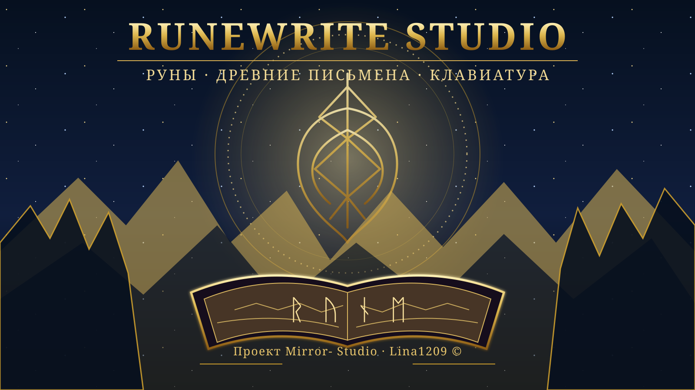

# ✦ RuneWrite Studio

### Рунический переводчик · древние письмена · виртуальная клавиатура

**Инструмент для знакомства с письменностями, преобразования текста, создания рунических надписей и работы с символами — прямо в браузере.**

[🌐 **Открыть приложение**](https://lina1209.github.io/Runeloom-/) · [📦 Репозиторий](https://github.com/Lina1209/Runeloom-) · [🗂 Releases](https://github.com/Lina1209/Runeloom-/releases)

---

## ✨ Что умеет RuneWrite Studio

RuneWrite Studio объединяет переводчик, клавиатуру, справочник знаков и инструменты для оформления текста в одном компактном веб-приложении. Интерфейс адаптирован для телефона и компьютера.

### 🔤 Переводчик и преобразование текста
- Преобразование русского и латинского текста в выбранную систему символов.
- Обратное преобразование рунических знаков в текст там, где для выбранной системы предусмотрена таблица обратного соответствия.
- Фонетические сочетания для некоторых латинских буквосочетаний — например, **th, sh, ch, ng**.
- Переключение направления: **Текст → знаки** и **Знаки → текст**.
- Настройка размера результата, фона (светлый, тёмный или прозрачный), копирование и PNG-экспорт.
- История недавних преобразований для быстрого повторного использования.

> Это инструмент сопоставления символов и стилизации, а не полноценный лингвистический переводчик. В древних письменностях многие буквы и звуки не имеют точного современного аналога; отображение зависит от выбранной таблицы.

### 📜 Системы письма и алфавиты

В приложении представлены:

**Рунические системы**
- Старший Футарк
- Младший Футарк — датский вариант (длинные ветви)
- Младший Футарк — шведско-норвежский вариант (короткие ветви)
- Англосаксонский Футорк
- Средневековые руны
- Арманен (18 рун)

**Древние письменности**
- Огам
- Готское письмо
- Древнеиталийское / этрусское
- Финикийское
- Орхон-Енисейское (древнетюркское)
- Древневенгерское письмо (роваш)
- Глаголица

**Фэнтези-алфавиты**
- Cirth — Кирт Толкина
- Aurebesh — алфавит Star Wars
- Theban — алфавит, используемый в современных оккультных традициях (для него требуется загрузить шрифт)

Список и доступность знаков зависят от используемого шрифта и таблиц соответствия.

### ⌨️ Виртуальная клавиатура
- Клавиши выбранного алфавита с подписью соответствующих букв.
- Ввод нажатием на экранные клавиши или обычную клавиатуру.
- Пробел, удаление последнего символа и очистка.
- Копирование результата, PNG-экспорт и перенос набранного текста в переводчик.

### 🧾 Таблица алфавита
Открывайте таблицу символов выбранной системы, рассматривайте знаки и нажимайте на них, чтобы добавить в рабочий текст.

### 📖 Рунические поэмы
Встроены тексты и краткие русские переводы:
- Англосаксонской рунической поэмы
- Исландской рунической поэмы Младшего Футарка

### ✨ Символы и знаки
Подборки для копирования: дополнительные рунические знаки, мистические символы, Луна и Солнце, алхимия, египетские знаки, символы природы и силы.

### 🎂 Рунические инструменты
- **Руна по дате рождения** — условная система календарного сопоставления с руной.
- **Руны имени** — преобразование имени в знаки Старшего Футарка и отображение кратких значений рун.

Эти разделы предназначены для символического и ознакомительного использования; трактовки не являются исторически универсальными.

### 🪄 Шрифты
- Встроенные веб-шрифты для различных письменностей.
- Основные пользовательские шрифты Lina Winter: **Руны Ведьм** и **Исландские руны**.
- Загрузка собственного **TTF, OTF или WOFF**-шрифта (до 8 МБ), проверка файла перед добавлением.
- Локальное сохранение пользовательских шрифтов в браузере, возможность выбрать и удалить их.
- Отдельная загрузка шрифта Theban.

### 📲 Установка и автономность
RuneWrite Studio оформлено как PWA (Progressive Web App): в совместимом браузере приложение можно установить на устройство. Service Worker обеспечивает кэширование оболочки и резервную загрузку страницы при отсутствии сети. **Некоторые шрифты и библиотеки загружаются из внешних источников, поэтому не все функции гарантированно доступны офлайн.**

---

## 🚀 Как пользоваться

1. Откройте приложение по ссылке ниже.
2. Выберите систему письма или шрифт.
3. Введите текст, выберите направление преобразования.
4. Скопируйте результат, сохраните изображение PNG или перейдите к клавиатуре.
5. Для своих шрифтов откройте вкладку **«Шрифты»**, выберите файл и добавьте его в приложение.

### [✨ ЗАПУСТИТЬ RUNEWRITE STUDIO ✨](https://lina1209.github.io/Runeloom-/)

---

## 🧭 Технологии

- HTML, CSS, JavaScript
- Unicode
- Web Fonts / FontFace API
- OpenType.js — анализ загружаемых font-файлов
- IndexedDB — хранение пользовательских шрифтов
- Local Storage — история преобразований
- Canvas — PNG-экспорт
- PWA Manifest + Service Worker

## 🛡️ Приватность

Текст преобразуется в браузере. История и добавленные пользовательские шрифты сохраняются локально в браузере на вашем устройстве. Удаление данных браузера может очистить эти сохранения. Не загружайте файлы, содержащие чувствительную информацию, в общедоступные или чужие устройства.

## 📌 Статус

Проект развивается. Состав алфавитов, таблицы преобразования, шрифты, совместимость браузеров и офлайн-поведение продолжают проверяться и улучшаться. Некоторые системы являются приблизительными таблицами сопоставления, а не научными транслитерациями.

---

## © Авторство

**RuneWrite Studio — проект Mirror- Studio · Lina1209 ©**

Проект, его интерфейс, подборки, реализация и оформление публикуются автором в этом репозитории. Используемые сторонние шрифты, библиотеки и материалы сохраняют лицензии и авторство их правообладателей. Перед использованием сторонних шрифтов в коммерческих проектах проверяйте их лицензии.

[🌐 Приложение](https://lina1209.github.io/Runeloom-/) · [GitHub](https://github.com/Lina1209/Runeloom-) · [Releases](https://github.com/Lina1209/Runeloom-/releases)

